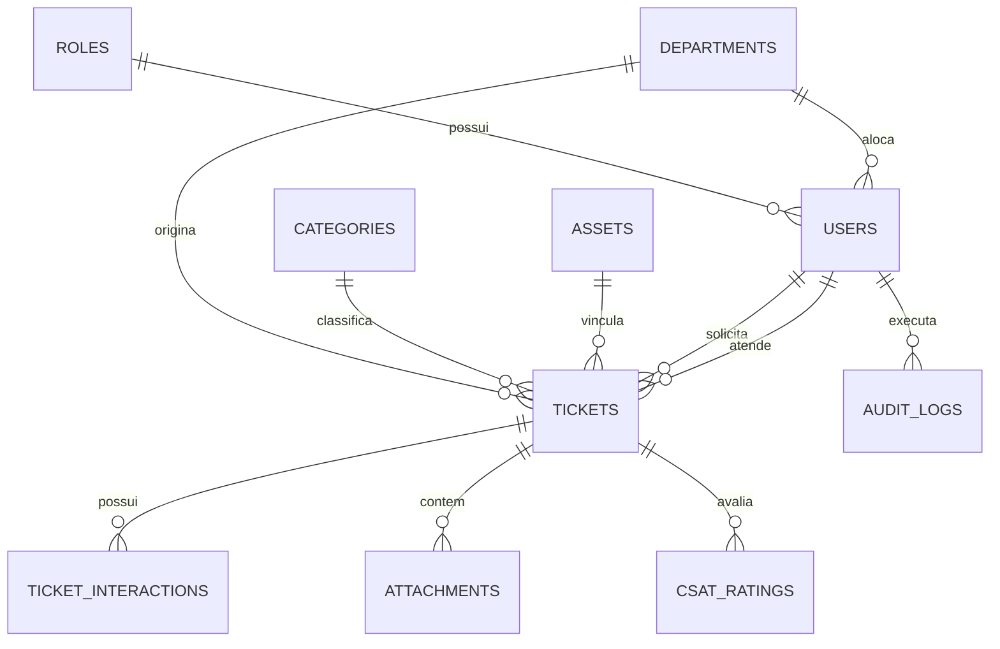

# 📐 Documentação Técnica de Arquitetura & Engenharia de Software
## HelpDesk Pro - Enterprise Service Desk & Gestão de TI

---

## 1. Visão Geral da Arquitetura

O sistema foi refatorado e projetado seguindo os princípios de **Clean Architecture** e **SOLID**, com separação clara de responsabilidades em camadas desacopladas:

```
[ Cliente SPA Web (HTML5 / Modern CSS / Vanilla JS) ]
                     │  HTTP / JSON (JWT Bearer)
                     ▼
             [ server.js ]
                     │
             [ Middlewares ]
  ├── Auth & RBAC Guard (JWT + Role verification)
  ├── Rate Limiter (Memory bucket per IP)
  ├── Input Sanitizer (XSS & Injection strip)
  └── Upload Engine (Multer MIME + Size filter)
                     │
            [ API Controllers ]
  (Validação de payload HTTP e formatação de resposta)
                     │
             [ Services / Use Cases ]
  (Regras de negócio, cálculo de SLA, ciclo de vida, auditoria)
                     │
            [ Repositories ]
  (Acesso a dados com consultas preparadas e seguras)
                     │
        [ SQLite Database Engine (WAL Mode) ]
```

---

## 2. Estrutura de Pastas e Módulos

```
sistema ti/
├── package.json                   # Dependências e scripts de execução
├── server.js                      # Ponto de entrada Express e configuração HTTP
├── iniciar-sistema.bat            # Script de inicialização com 1 clique no Windows
├── README.md                      # Instruções de uso e credenciais
├── DOCUMENTACAO.md                # Este documento técnico detalhado
├── uploads/                       # Armazenamento de anexos validados
├── data/                          # Banco de dados persistente (helpdesk.sqlite)
├── src/
│   ├── config/
│   │   └── appConfig.js           # Variáveis globais, limites e segredos JWT
│   ├── domain/
│   │   ├── enums.js               # Enums: Roles, TicketStatus, Priority, etc.
│   │   └── slaRules.js            # Motor de cálculo e conformidade de SLAs
│   ├── database/
│   │   ├── connection.js          # Conexão nativa node:sqlite em WAL Mode
│   │   ├── migrations.js          # Schemas DDL e criação de índices
│   │   └── seeders.js             # Carga inicial com admin, técnicos e chamados
│   ├── repositories/
│   │   ├── userRepository.js      # CRUD e consultas de usuários
│   │   ├── ticketRepository.js    # Consultas paginadas e filtros avançados
│   │   ├── interactionRepository.js # Timeline, notas internas e públicas
│   │   ├── departmentRepository.js# Departamentos da empresa
│   │   ├── categoryRepository.js  # Categorias de problemas e SLAs padrão
│   │   ├── assetRepository.js     # Inventário de patrimônio corporativo
│   │   ├── kbRepository.js        # Base de conhecimento e busca de autoajuda
│   │   ├── csatRepository.js      # Pesquisa de satisfação do usuário
│   │   ├── attachmentRepository.js# Metadados de arquivos anexados
│   │   └── auditLogRepository.js  # Registro imutável de auditoria
│   ├── services/
│   │   ├── authService.js         # Autenticação, hash bcrypt e tokens
│   │   ├── ticketService.js       # Regras de ciclo de vida e atribuição
│   │   ├── interactionService.js  # Mensagens públicas e notas internas
│   │   ├── dashboardService.js    # Cálculo de MTTR, MTTA e matriz mês a mês
│   │   └── notificationService.js # Alertas no sistema e webhooks corporativos
│   ├── middlewares/
│   │   ├── authMiddleware.js      # Validador de token JWT
│   │   ├── rbacMiddleware.js      # Controle de acesso por perfil
│   │   ├── rateLimitMiddleware.js # Rate limit por IP
│   │   ├── uploadMiddleware.js    # Validador de tipo MIME e tamanho
│   │   ├── sanitizeMiddleware.js  # Sanitizador anti-XSS
│   │   └── errorHandler.js        # Tratamento centralizado de exceções
│   ├── controllers/
│   │   ├── authController.js
│   │   ├── userController.js
│   │   ├── ticketController.js
│   │   ├── departmentController.js
│   │   ├── categoryController.js
│   │   ├── assetController.js
│   │   ├── dashboardController.js
│   │   ├── kbController.js
│   │   ├── csatController.js
│   │   └── auditController.js
│   └── routes/
│       └── apiRouter.js           # Roteador unificado da API REST
└── public/                        # Frontend Single Page Application (SPA)
    ├── index.html                 # Estrutura semântica e modais
    ├── css/
    │   └── styles.css             # Design System HSL, Dark/Light Mode e responsividade
    └── js/
        ├── api.js                 # Cliente HTTP com interceptors
        ├── state.js               # Estado reativo e controle de permissões
        ├── app.js                 # Controlador principal da aplicação
        └── components/
            ├── tickets.js         # Listagem, busca e paginação
            ├── ticketDetail.js    # Modal detalhado, timeline e notas internas
            ├── dashboard.js       # Gráficos Chart.js e matriz mês a mês
            ├── kb.js              # Base de conhecimento e sugestão na digitação
            ├── assets.js          # Inventário de patrimônio
            └── users.js           # Administração de usuários e auditoria
```

---

## 3. Modelo de Dados Relacional (Schema DDL)

O banco de dados relacional é estruturado em SQLite com chaves estrangeiras ativas (`PRAGMA foreign_keys = ON;`) e WAL Mode:

### Entidades Principais:



1. **`roles`**: Perfis de acesso (`admin`, `technician`, `employee`).
2. **`departments`**: Setores corporativos (TI, Financeiro, RH, Comercial, Logística, etc.).
3. **`users`**: Usuários cadastrados com `password_hash` (bcrypt), `role_id`, `department_id` e controle de status `is_active`.
4. **`categories`**: Tipos de incidentes com prioridade padrão e horas de SLA vinculadas.
5. **`assets`**: Inventário de hardware e patrimônio vinculado ao colaborador ou setor.
6. **`tickets`**: Chamados contendo status, prioridade, prazos de SLA calculados (`first_response_due_at`, `resolution_due_at`), data de resolução, causa raiz e tempo gasto.
7. **`ticket_interactions`**: Linha do tempo interativa com flag `is_internal` (privado para TI) e mensagens públicas.
8. **`attachments`**: Arquivos validados com caminho, tamanho e tipo MIME.
9. **`csat_ratings`**: Pesquisa de satisfação pós-atendimento (1 a 5 estrelas).
10. **`audit_logs`**: Tabela imutável para rastreabilidade de todas as alterações.

---

## 4. Matriz de SLA e Regras de Negócio

| Prioridade | Prazo Limite 1ª Resposta (MTTA) | Prazo Limite Resolução (MTTR) | Critério de Negócio |
| :--- | :--- | :--- | :--- |
| **Crítica** | **1 hora** | **4 horas** | Parada total de operação ou impacto em faturamento/diretoria |
| **Alta** | **2 horas** | **8 horas** | Queda de rede setorial ou sistema de vendas indisponível |
| **Média** | **4 horas** | **24 horas** | Lentidão de estação de trabalho ou falha de software não bloqueante |
| **Baixa** | **8 horas** | **48 horas** | Requisições de software, impressoras secundárias ou dúvidas |

* **Detecção de Violação (Breach)**:
  - Calculado dinamicamente: se a data de encerramento ultrapassar a data limite, o chamado é marcado como `BREACHED` (SLA Violado).
  - Alerta preventivo automático quando 75% do prazo limite já tiver decorrido.

---

## 5. Endpoints da API RESTful

Todas as respostas da API seguem o padrão padronizado:
```json
{
  "success": true,
  "data": { ... },
  "pagination": { "page": 1, "limit": 10, "total": 4, "totalPages": 1 }
}
```

### Autenticação & Perfil
* `POST /api/auth/login` - Autenticação com e-mail e senha, retornando JWT.
* `POST /api/auth/forgot-password` - Solicitação de token seguro para reset.
* `POST /api/auth/reset-password` - Redefinição de senha com token.
* `GET  /api/auth/me` - Perfil do usuário autenticado.

### Chamados (Tickets)
* `GET   /api/tickets` - Listagem paginada com filtros por status, prioridade, categoria e busca textual.
* `GET   /api/tickets/:id` - Visualização completa do ticket, anexos, conformidade SLA e timeline.
* `POST  /api/tickets` - Abertura de chamado com cálculo automático de SLA e upload de anexo.
* `POST  /api/tickets/:id/assign` - Atribuição de técnico ("Assumir Chamado").
* `PATCH /api/tickets/:id/status` - Transição de status e registro de solução técnica.
* `POST  /api/tickets/:id/interactions` - Envio de mensagem pública ou **nota técnica interna**.
* `POST  /api/tickets/:id/attachments` - Upload adicional de anexo.

### Dashboard & Inteligência
* `GET  /api/dashboard/metrics` - Indicadores executivos (Total, Abertos, MTTR, MTTA, % SLA, CSAT).
* `GET  /api/dashboard/monthly-matrix` - Cruzamento analítico Mês a Mês das categorias de incidentes.

### Módulos Complementares
* `GET  /api/kb` & `GET /api/kb/suggest?q=...` - Base de conhecimento e auto-sugestão proativa.
* `POST /api/csat` - Envio de pesquisa de satisfação (1-5 estrelas).
* `GET  /api/assets` - Inventário de equipamentos de TI.
* `GET  /api/users` - Gestão corporativa de usuários (Admin).
* `GET  /api/audit` - Visualização de logs imutáveis de auditoria (Admin).
